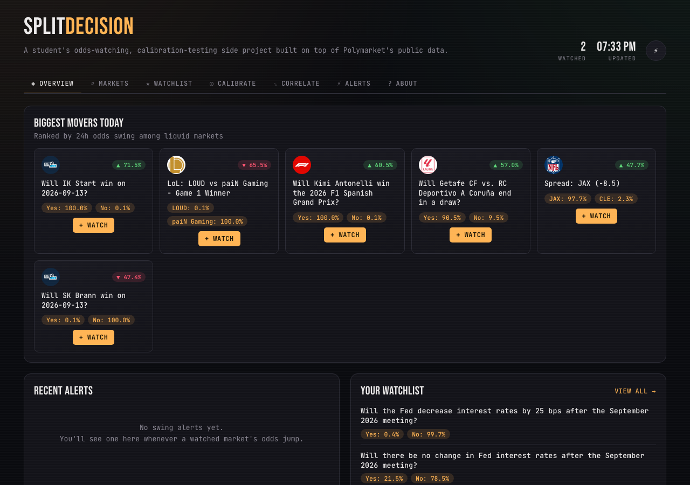

# Split Decision

A student side project for watching [Polymarket](https://polymarket.com) prediction
markets — and for finding out whether I'm actually any good at guessing
probabilities, or just confident. Browse by category, watchlist what you care
about, get alerted when the odds swing, log your own call before you see the
market's price, and see whether related markets move together.

No trading logic here — this is read-only tracking against Polymarket's public
Gamma (market metadata) and CLOB (price/order-book) APIs, no wallet, no API key.
The **About** tab in the app has the full story: why this exists, how Polymarket
actually works under the hood, and how this project works.



## Features

- **Seven-tab dashboard** (Overview / Markets / Watchlist / Calibrate / Correlate
  / Alerts / About) with the active tab kept in the URL hash, so back/forward and
  bookmarking work.
- **Overview** surfaces the biggest 24h odds movers among liquid markets, plus a
  glance at your watchlist and recent alerts.
- **Markets** browse view with real Polymarket category tabs (Politics, Crypto,
  Culture, AI, Sports, Business, World, ...) so you're not stuck looking at
  whatever has the most raw volume (usually repetitive sports/Fed-rate markets) —
  debounced search and a sort control (trending / all-time volume / ending soon)
  layer on top.
- **Calibrate** — the signature feature: lock in your own probability guess on a
  watchlisted market *before* you check the price. Once the market resolves, it's
  scored against the market's own implied probability with a Brier score, so you
  can actually tell whether you're well-calibrated or just confident.
- **Correlate** — pick two watchlisted markets and see whether their odds move
  together, with a Pearson correlation coefficient computed over your own
  collected history (e.g. does a Fed-rate market track a Bitcoin-price market?).
- **Swing alerts**: the backend poller compares consecutive snapshots for every
  watchlisted market and fires an alert when an outcome's price moves by more
  than a configurable threshold (default 5 percentage points). Alerts show up as
  toasts, a badge on the bell icon, and a full feed in the Alerts tab.
- Market cards show a thumbnail, category tag, a probability bar per outcome, and
  a 24h change badge (from Polymarket's own `oneDayPriceChange` field).
- A terminal-meets-sportsbook look (JetBrains Mono + Bebas Neue, amber/green
  accents, scanline texture) instead of generic SaaS-blue.

## Architecture

- `backend/` — Python (FastAPI). Polls watchlisted markets on an interval
  (APScheduler), detects odds swings and records alerts, resolves open
  predictions and scores them (Brier), and stores snapshots (outcome prices,
  volume, liquidity, 24h change) in SQLite. Exposes a small REST API for the
  frontend, with upstream API failures mapped to clean 502 responses instead of
  raw 500s.
- `frontend/` — React + TypeScript (Vite). Tab-based navigation, category
  filtering, watchlisting, calibration tracking, correlation charting, and toast
  notifications (Sonner) for watchlist actions and swing alerts.

## Setup

### Backend

```bash
cd backend
python3 -m venv .venv
source .venv/bin/activate
pip install -r requirements.txt
uvicorn app.main:app --reload
```

Runs on `http://localhost:8000`. On startup it initializes `backend/data/polymarket.db`
and starts polling any watchlisted markets every `POLL_INTERVAL_SECONDS` (default 300s).
Copy `.env.example` to `.env` to override any defaults (DB path, poll interval,
odds-swing alert threshold, allowed frontend origin, API bases).

Run the test suite with:

```bash
python -m pytest
```

### Frontend

```bash
cd frontend
npm install
npm run dev
```

Runs on `http://localhost:5173` and proxies `/api` to the backend.

## How it works

1. Browse by category or search (pulled live from Polymarket's Gamma API), sorted by
   trending volume, all-time volume, or end date.
2. Click "Watch" on a market — it's saved to the watchlist and an initial snapshot is recorded.
3. On a watchlist card, lock in your own probability call before checking the
   market's price — that's stored alongside the market's price at that moment.
4. The backend's scheduler re-fetches each watchlisted market's current prices/volume/24h
   change every poll interval, appends a snapshot row, and compares it against the
   previous snapshot — a move past the swing threshold creates an alert. Once a
   market closes, any open prediction on it is scored (your call vs. the market's)
   with a Brier score.
5. The frontend polls `/api/alerts` and toasts any alert it hasn't seen yet; the
   bell badge and Alerts tab reflect the current unread count (tracked locally).
6. The watchlist panel charts accumulated snapshots per market; the Correlate tab
   compares two markets' histories directly.

## Notes / next steps

- Polymarket's public API surface can change; if `polymarket_client.py` starts
  returning empty results, check https://docs.polymarket.com/ for updated
  endpoint shapes. Category tag ids in `app/categories.py` come from
  `gamma-api.polymarket.com/tags/slug/<slug>` and should be stable, but verify
  if a category tab starts returning nothing.
- History, alerting, and calibration all only exist from the moment a market is
  watchlisted onward — there's no backfill of past odds.
- Alerts compare *consecutive polls*, so the effective sensitivity depends on
  `POLL_INTERVAL_SECONDS` — a fast-moving market can cross the threshold multiple
  times between polls without each intermediate move being caught.
- Natural extensions: cross-market arbitrage/consistency scanning, exporting
  snapshots to CSV/Parquet for offline analysis, push notifications instead of
  in-app toasts, or swapping SQLite for Postgres if the watchlist grows large.
